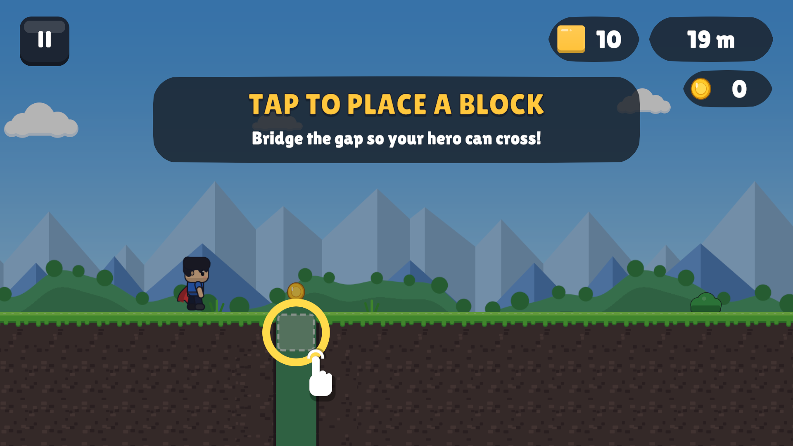

# One Block

**One tap. One block. One more run.** An endless tap-to-build runner for Android, live on Google Play.

## About

Your hero never stops running and there's no jump button. Every tap drops a block where you need it: bridge a gap, climb a wall, cover spikes or squash an enemy.

- 3 modes: Endless Run, One Block Challenge and a Daily Challenge with streaks
- 8 worlds, each with its own hazards and enemies
- Unlockable heroes, block skins, trails and effects
- Missions, XP levels and an original 9-track soundtrack
- Free to play with optional rewarded ads (AdMob)

## Built with

Unity 6.5 (2D URP) · C# · Google AdMob · Android

## Run it

1. Open the folder in Unity Hub (Unity 6.5).
2. Open `Assets/_Game/Scenes/Game.unity` and press **Play**.

## Links

- [Get it on Google Play](https://play.google.com/store/apps/details?id=com.oneblock.game)

## My role

Built with AI-assisted development. I designed the game and directed, tested and released it on Google Play.
